# Ring-Oscillator-GPDK090

**A five-stage CMOS ring oscillator built from a custom inverter in Cadence Virtuoso using the planar gpdk090 (90 nm) PDK, with schematic-to-post-layout comparison.**

   

## 2. Headline result

**Extracted parasitics reduce the measured oscillation frequency from 7.04 GHz to 4.28 GHz (−39.2%) and increase the inferred per-stage propagation delay by 64.5%.** Measurements use adjacent peaks on `/vout!` in a 0–5 ns transient simulation.

| Netlist/view | Adjacent peak markers | Period, `T` | Frequency, `f` | `t_pd = T/(2N)`, `N = 5` |
|---|---|---:|---:|---:|
| `schematic` | 203.87 ps, 345.95 ps | 142.08 ps | **7.04 GHz** | 14.2 ps |
| `av_extracted` | 335.67 ps, 569.40 ps | 233.73 ps | **4.28 GHz** | 23.4 ps |
| **Change** | — | — | **−39.2%** | **+64.5%** |

| Schematic transient (`M7/M8`) | Extracted transient (`M5/M6`) |
|---|---|
| 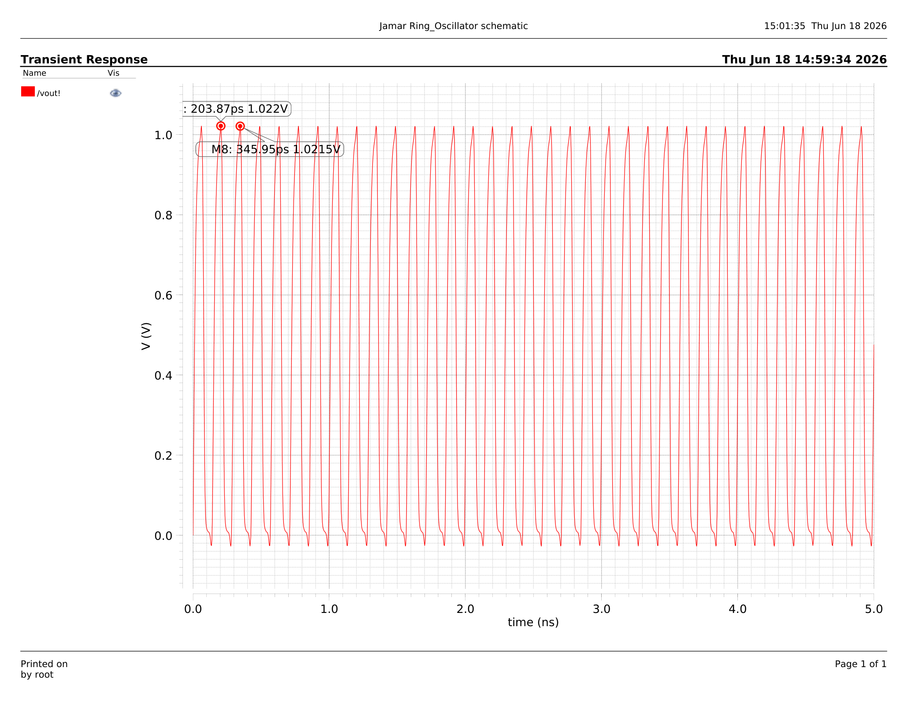 | 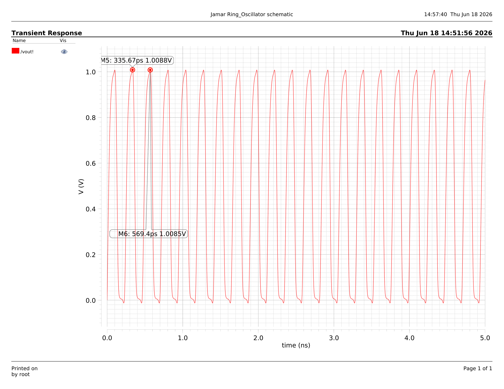 |

Extracted wiring capacitance loads each inverter stage, increasing `t_pd` and lowering `f`. The waveform has narrow peaks reaching approximately 1.02 V and slight undershoot; it is not an ideal square wave. These are **single-cycle** readings: an earlier schematic reading was 7.18 GHz, so allow approximately **±2% marker-reading uncertainty**.

Original waveform exports: [schematic PDF](results/Ring_Oscillator_Schematic.pdf) · [extracted PDF](results/Ring_Oscillator_AV_Extracted.pdf).

## 3. Background

An odd number of cascaded inverters connected in a feedback loop cannot maintain a stable self-consistent Boolean output while the transitions propagate around the loop. The propagation delays allow successive inversions to produce oscillation. An even-inverter loop can latch instead.

For `N` identical inverter stages with per-stage delay `t_pd`:

$$
f \approx \frac{1}{2Nt_{pd}}, \qquad N=5
$$

The delay values reported here are **inferred** from the measured oscillator period, rather than measured independently from inverter `t_pLH` and `t_pHL`.

**TODO: Document the start-up method used to initiate oscillation.**

## 4. Design flow


All design and extraction work described here uses **gpdk090**, not a FinFET PDK. DRC and LVS were performed with **Assura**, not PVS.

## 5. Building block: CMOS inverter

### Device sizing and bias

Library: `Jamar`; cell: `inverter`; views: `schematic`, `symbol`, `layout`, and `av_extracted`.

| Parameter | PMOS | NMOS |
|---|---:|---:|
| gpdk090 device | `pmos1v` | `nmos1v` |
| Width, `W` | 120 nm | 120 nm |
| Length, `L` | 100 nm | 100 nm |
| Multiplicity, `m` | 1 | 1 |
| Supply, `VDD` | 1 V | 1 V |

| Transistor-level schematic | Reusable inverter symbol |
|---|---|
| 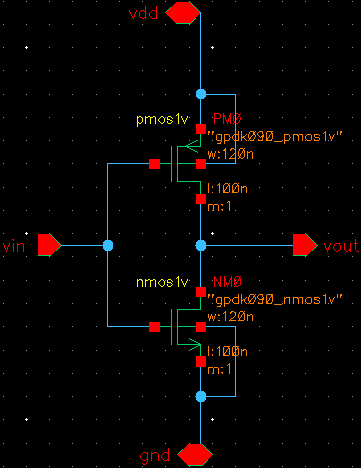 | 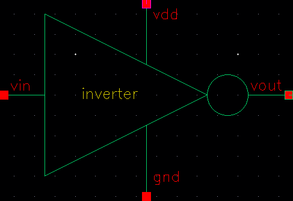 |

### Testbench and electrical response

The `Jamar/inverter_sim` schematic drives `vin` with `vpulse` and applies a 1 V DC supply. Outputs observed were `/vout` and supply current. Simulations included a **100 ns transient** and a **0–1 V DC input sweep**.

| Testbench item | Setting |
|---|---|
| `vpulse` initial level, `v1` | 1 V |
| `vpulse` pulsed level, `v2` | 0 V |
| Input rise time, `tr` | 50 ps |
| `vpulse` period / pulse width | **TODO: Enter period and pulse width used.** |
| Supply voltage | 1 V DC |
| Transient stop time | 100 ns |
| DC sweep | `vin`: 0–1 V |
| Simulation corner / temperature | **TODO: Identify simulation process corner and temperature.** |

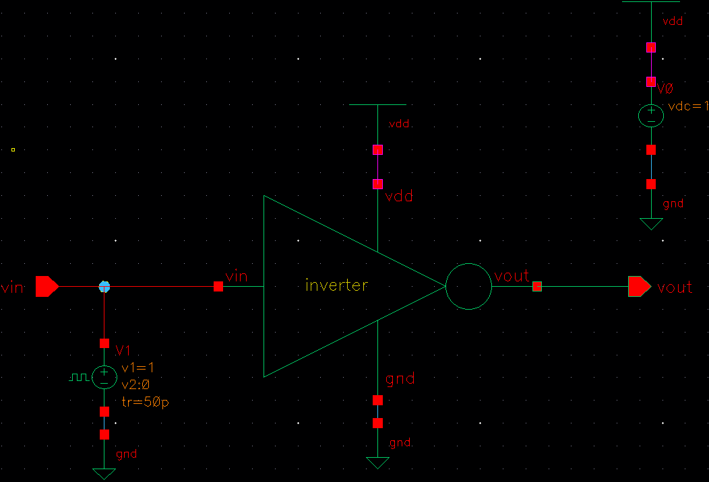

| Observation | Result |
|---|---|
| Switching threshold, `VM` | ≈ 0.41 V, at `vin = vout` in the VTC |
| DC supply-current maximum | ≈ 9 µA, near `VM` |
| Schematic transient-current peak | 18.8 µA |
| Extracted transient-current peak | 26.1 µA |
| Transient output | Full rail-to-rail inversion |

`VM` lies below `VDD/2`, consistent with equal NMOS/PMOS widths and a weaker pull-up. The DC-current maximum occurs around the switching point (crowbar current). Supply-current spikes appear at input transitions. The pre- and post-layout **DC transfer curves overlay**: the added parasitic capacitances affect dynamic behavior rather than the static transfer characteristic.

| Schematic inverter transient | Extracted inverter transient |
|---|---|
| 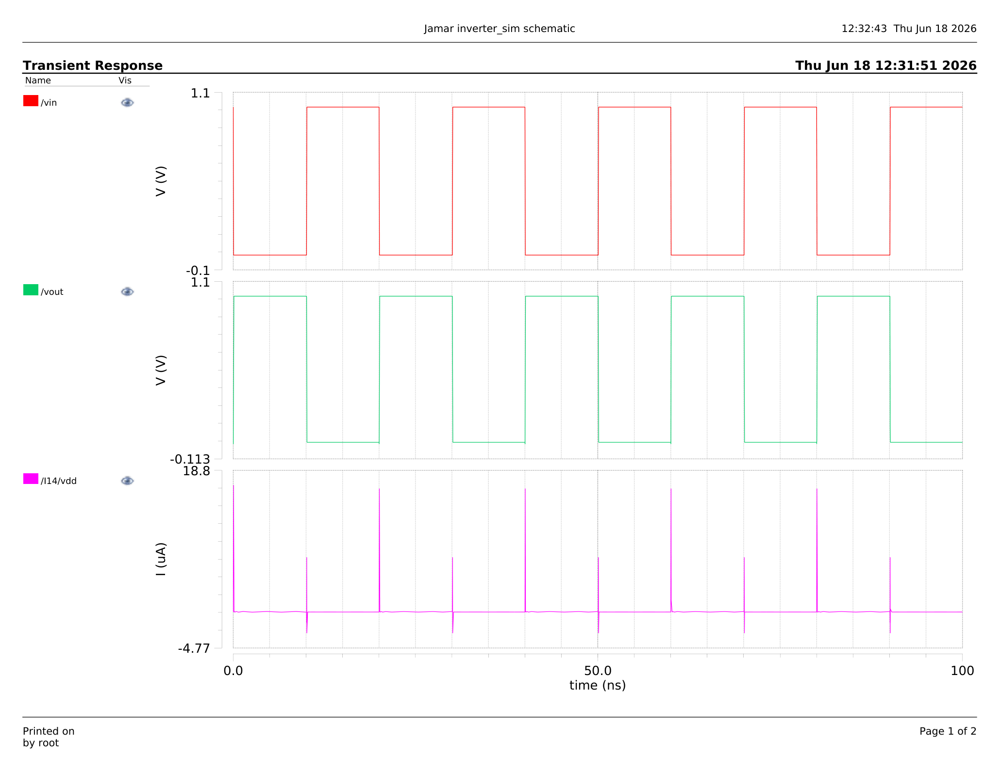 | 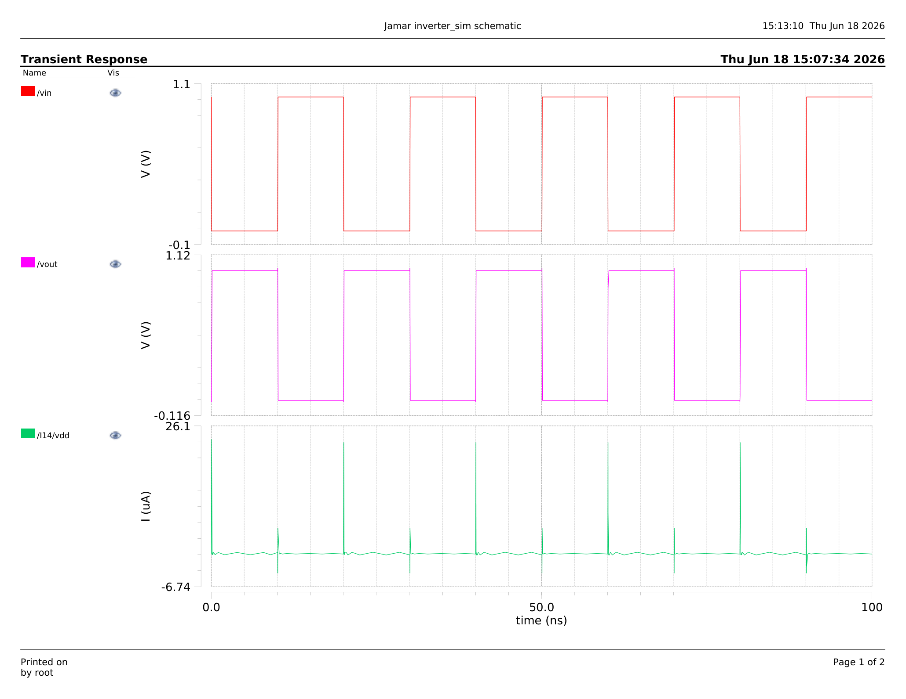 |

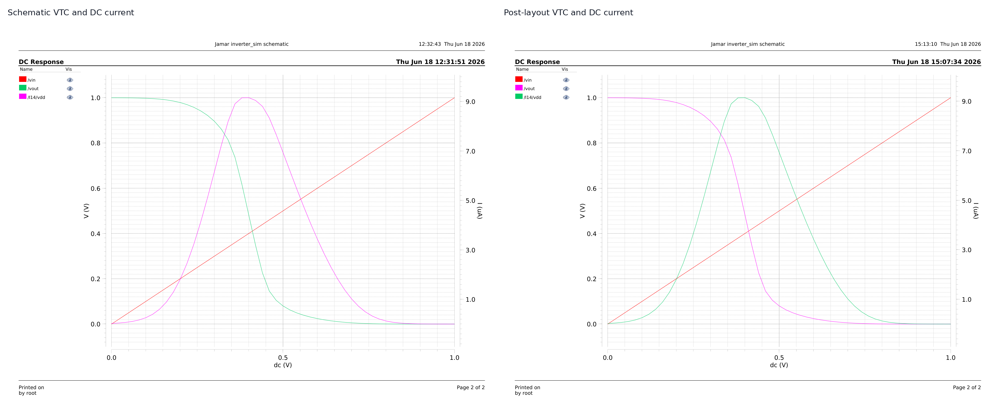

Original result exports: [schematic inverter PDF](results/Inverter_Schematic.pdf) · [extracted inverter PDF](results/Inverter_AV_Extracted.pdf).

### Inverter layout

The PMOS sits above the NMOS, with a shared polysilicon gate and layout pins `vin`, `vout`, `vdd`, and `gnd`.

| Inverter layout | Inverter extracted view |
|---|---|
| 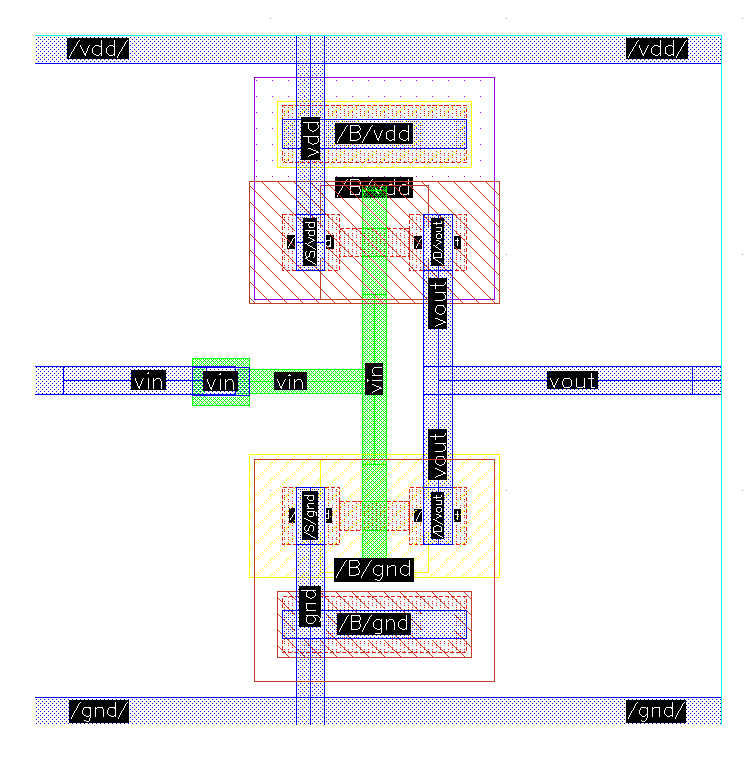 | 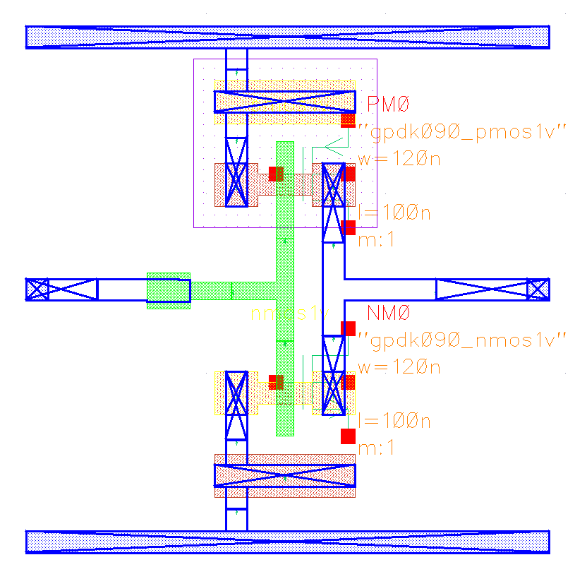 |

## 6. Ring oscillator implementation

`Jamar/Ring_Oscillator` consists of five instances of the verified inverter connected in series with the last output fed back to the first input. The internal stage nets are `net1` through `net4`; feedback and the observed output use `vout!`. The global power nets are `vdd!` and `gnd!`.

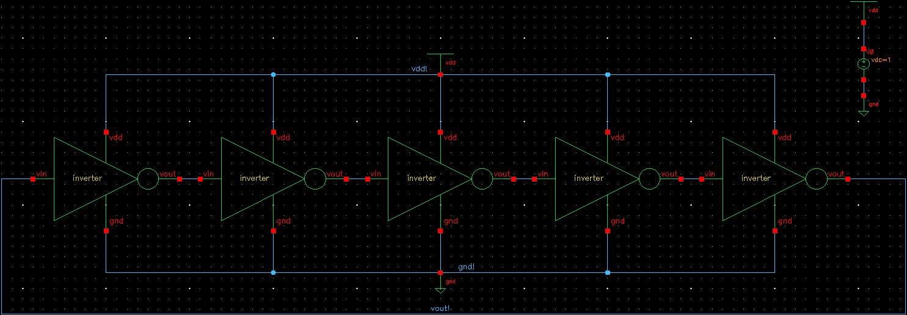

The layout is **hierarchical**: the same verified inverter layout is instantiated five times. Shared power rails distribute `vdd!` and `gnd!`; Metal1 connects adjacent stages. The `vout!` feedback goes to Metal2 through Via1 to cross the `gnd!` strap without shorting, then returns to Metal1.

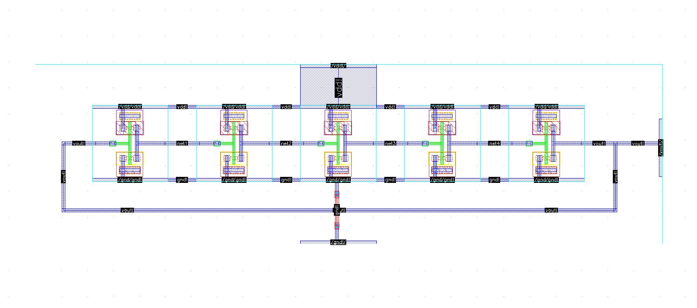

| Top-level pin | Function |
|---|---|
| `vdd!` | Global positive rail |
| `gnd!` | Global ground rail |
| `vout!` | Feedback net and monitored output `/vout!` |

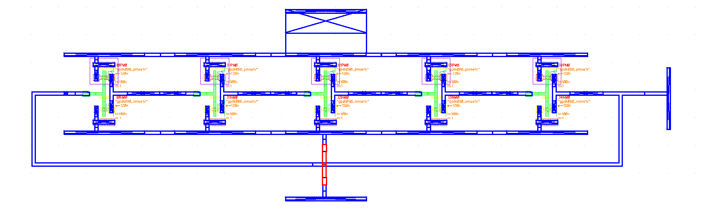

## 7. Physical verification and extraction

| Check | Inverter | `Ring_Oscillator` |
|---|---|---|
| DRC tool | Assura | Assura |
| Final DRC | 0 violations | 0 violations |
| LVS tool | Assura | Assura (hierarchical) |
| LVS result | “Schematic and Layout Match” | “Schematic and Layout Match” |
| Extracted nets | 4 | 7 |
| Extracted resistors | 16 | 99 |
| Extracted capacitors | 12 | 63 |
| Devices | 1 NMOS + 1 PMOS | 5 NMOS + 5 PMOS |
| Extraction temperature | 25 °C | 25 °C |
| Capacitive treatment | Decoupled | Decoupled |

Quantus initially reported **141 ring resistors before reduction**, with **99** remaining in the extracted result. In *decoupled* capacitance mode, coupling is lumped to ground. The extracted `av_extracted` views contain `analogLib` `presistor` and `pcapacitor` instances.

During ring layout verification, Assura identified **2 × `METAL1.SP.1.1`** spacing violations. The rule requires Metal1-to-Metal1 spacing of at least **0.12 µm**. Both were resolved by moving the wires apart before the final clean DRC run.

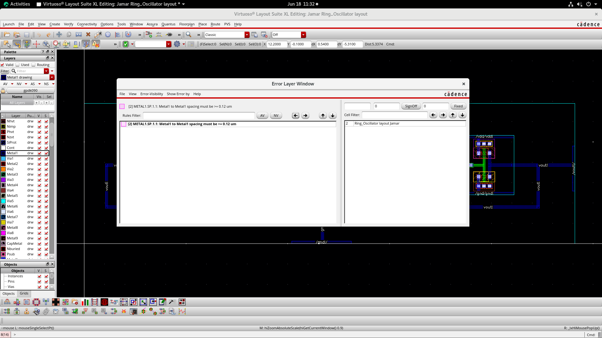

## 8. Post-layout analysis

| Metric or behavior | `schematic` | `av_extracted` | Interpretation |
|---|---:|---:|---|
| Inverter switching threshold, `VM` | ≈ 0.41 V | DC curves overlay | No reported static VTC shift |
| Inverter peak transient supply current | 18.8 µA | 26.1 µA | Larger extracted transient peak |
| Inverter inversion | Rail-to-rail | Rail-to-rail | Logic inversion retained |
| Ring period | 142.08 ps | 233.73 ps | Period increases |
| Ring frequency | 7.04 GHz | 4.28 GHz | Frequency decreases |
| Ring `t_pd`, inferred | 14.2 ps | 23.4 ps | Effective stage delay increases |

Three takeaways:

1. **Pre-layout frequency overestimates the extracted result** for this layout; the measured frequency reduction is 39.2%.
2. **Capacitive parasitics chiefly alter dynamic response** in these observations: the inverter VTC overlays, but its current peaks and the oscillator period change.
3. **Verification and extraction are distinct milestones:** passing Assura DRC/LVS confirms the checked physical/connectivity rules, while Quantus RC extraction supplies the parasitics needed for post-layout timing comparison.

The inverter and ring oscillator each have `av_extracted` views. Post-layout analysis uses these views in Spectre, not the schematic-only representations.

## 9. How to reproduce

**Prerequisites:** access to Cadence Virtuoso, Spectre, Assura, Quantus, and the **gpdk090 v4.6** PDK in a properly configured lab environment. This README is not a standalone EDA installation or a packaged PDK.

1. **Library Manager → File → New → Library:** create/select `Jamar` and associate it with the lab's gpdk090 technology setup. Create `inverter` (`schematic`, `symbol`, `layout`) and `inverter_sim` (`schematic`) as shown above.
2. **Schematic Editor → Design → Check and Save:** build the `pmos1v`/`nmos1v` inverter with the stated dimensions, then create its `symbol`. Use consistent supply nets; where global nets are required, use `vdd!` and `gnd!`.
3. **ADE L → Setup → Model Libraries:** include **only gpdk090** model files; do not also load gpdk045 or `cds_ff_mpt`. **TODO: Identify the exact gpdk090 model-file selection and simulation corner.**
4. **ADE L → Analyses → Choose:** configure the inverter's **0–1 V DC sweep** and **100 ns transient** with the 1 V supply and pulse settings above. **TODO: Add the missing pulse period and width.** Plot `/vout` and supply current.
5. **Layout Editor → Assura → Run DRC / Run LVS:** finish the inverter layout, clear DRC, and confirm **“Schematic and Layout Match.”**
6. **Library Manager → `Jamar/Ring_Oscillator/schematic`:** instantiate five inverter symbols; connect `net1`–`net4`, `vout!`, `vdd!`, and `gnd!`. **ADE L → Analyses → Choose:** run **0–5 ns** transient analysis on `/vout!`. **TODO: Record the oscillation start-up method.**
7. **Waveform viewer → Markers:** select **adjacent peaks** of `/vout!` and subtract their time coordinates to obtain `T`; calculate `f = 1/T` and `t_pd = T/10`. The reference marker readings are in the headline table.
8. **Layout Editor → Create → Instance:** place the inverter layout five times, join stage outputs on Metal1, and route the Metal2/Via1 `vout!` feedback crossing. **Assura → Run DRC / Run LVS:** clear the Metal1 spacing violations and confirm hierarchical LVS match. **TODO: Verify the exact placement command used in this lab setup.**
9. **Layout Editor → Quantus → parasitic extraction:** extract RC for both layouts with **decoupled** capacitance at **25 °C** and generate `av_extracted` views. **TODO: Confirm the exact Quantus menu command/form steps used.**
10. **ADE L → Setup → Environment:** put `av_extracted` **before** `schematic` in the **Switch View List**, then re-netlist. **ADE L → Setup → Model Libraries:** provide extracted `cmodel` and `rmodel` model definitions if required. **TODO: Confirm the exact include-file contents and steps used for these model definitions.**
11. **ADE L → Analyses → Choose / waveform viewer → Markers:** repeat the ring **0–5 ns** transient with `av_extracted`, record adjacent-peak times, and compare period, frequency, and inferred stage delay. Repeat the inverter DC/transient analysis to compare VTC and supply-current peaks.

## 10. Troubleshooting log

| Symptom | Cause | Fix / status |
|---|---|---|
| Spectre `SFE-59` / `SFE-396`: model “already defined” | gpdk045 and `cds_ff_mpt` model files loaded alongside gpdk090 | **ADE L → Setup → Model Libraries:** keep only gpdk090 models. |
| `SCH-7003`: short between `gnd!` and `gnd` (similarly `vdd!` and `vdd`) during Check & Save | Rails labeled with local `gnd`/`vdd` while inverter pins expect global `gnd!`/`vdd!` | Relabel global rails with `!`, or use the appropriate global symbols. |
| Calculator `frequency()` expression fails on `VF` data | Transient signal is time-domain; `VF` is not the time-domain waveform accessor for the measurement | Use `VT("/vout!")`, or place adjacent-peak time markers and compute the period. |
| Assura DRC: `METAL1.SP.1.1` × 2 | Metal1 wires were too close | Move their edges apart until spacing is at least **0.12 µm**; final DRC = 0 violations. |
| `vout!` feedback crosses the `gnd!` strap | Same-layer crossing would create a short | Hop from Metal1 to Metal2 using Via1 and return after the crossing. |
| ADE L did not offer `av_extracted`; subsequent Spectre `SFE-23`: undefined `cmodel` | Switch View List did not prioritize `av_extracted`; extracted capacitor and resistor model names were undefined | **Setup → Environment:** place `av_extracted` ahead of `schematic`, re-netlist. Add an include defining `cmodel` (capacitor) and `rmodel` (resistor) under **Setup → Model Libraries**. **TODO: Confirm the exact include-file definitions and applied steps.** |
| Layout pins did not snap to the intended outline | **TODO: Confirm the underlying cause from the recorded layout session.** | **TODO: Record the correction used.** See [pin-placement screenshot](assets/Pins_Not_Snapping_to_outline.png). |
| Assura technology-library selection required attention during DRC setup | **TODO: Confirm whether this was a configuration error or a normal setup step.** | **TODO: Record the specific action taken and outcome.** See [technology selection screenshot](assets/Assura_Tech_Lib.png). |

Additional calculation-error evidence is in [the ViVA screenshot](assets/expression_evaluation_failed.png). The saved screenshots document the UI state; the rows marked TODO do not claim a verified root cause or fix.

## 11. Repository structure

The repository uses the **existing** `schematic/`, `layout/`, `results/`, and `assets/` folders. The `plots/` previews below are PNG exports of the supplied PDF results, included with this README as a companion set of files. Paths and filename case matter on GitHub.

```text
Ring-Oscillator-GPDK090/
├── README.md
├── .gitignore
├── .gitattributes
├── schematic/
│   ├── Inverter.png
│   ├── Inverter_Symbol.png
│   ├── Inverter_TestBench.png
│   └── Ring_Oscillator.png
├── layout/
│   ├── Inverter_layout.png
│   ├── Inverter_layout_2.png
│   ├── Inverter_av_extracted.png
│   ├── Ring_Oscillator_layout.png
│   ├── Ring_Oscillator_layout_2.png
│   ├── Ring_Oscillator_av_extracted.png
│   └── Ring_Oscillator_av_extracted_2.png
├── results/
│   ├── Inverter_Schematic.pdf
│   ├── Inverter_AV_Extracted.pdf
│   ├── Ring_Oscillator_Schematic.pdf
│   └── Ring_Oscillator_AV_Extracted.pdf
├── plots/                         # PNG previews supplied with this README
│   ├── inverter_vtc.png
│   ├── inverter_transient_pre.png
│   ├── inverter_transient_post.png
│   ├── ring_transient_pre.png
│   └── ring_transient_post.png
├── assets/                        # Cadence screenshots and troubleshooting evidence
│   └── Screenshots/                # Additional saved layout screenshots
├── Jamar/                         # Local project design-data folder in supplied ZIP
└── cache/                         # Local extraction/cache folder in supplied ZIP
```

**Not included as redistributable dependencies:** the gpdk090 PDK, its process/model installation, Cadence software binaries or installation libraries, and license infrastructure. The supplied ZIP **does** contain local design-data and cache directories (`Jamar/`, `cache/`); those are not a substitute for an authorized gpdk090 installation and should be reviewed before publishing. The `.git/` history is also present in the supplied ZIP but is not part of the documented source tree.

**TODO: Add and verify `docs/Ring_Oscillator_MiniProject.pptx` (11-slide presentation); it was not found in the supplied ZIP.**

## 12. Limitations and future work

| Current limitation | Planned improvement |
|---|---|
| Frequency measured from one adjacent-peak interval; approximately ±2% reading uncertainty | Average period over many cycles and report the method |
| One simulation corner; corner/temperature not recorded here | Sweep process corner, supply voltage, and temperature |
| Quantus decoupled-capacitance mode | Compare with coupling-aware extraction |
| No output buffer | Evaluate buffered and unbuffered outputs |
| No power figures reported | Characterize power with defined measurement conditions |
| One stage count and equal PMOS/NMOS widths | Sweep inverter count `N` and ratio `Wp/Wn` |
| Inverter `t_pLH`/`t_pHL` not separately tabulated | Measure `t_pLH` and `t_pHL` pre- and post-layout |

## 13. Tools and versions

| Component | Version / role |
|---|---|
| Cadence Virtuoso | IC 6.1.8; schematic and layout — **TODO: confirm in Help → About** |
| Spectre | 21.1; circuit simulation — **TODO: confirm in Help → About** |
| Assura | 4.1; DRC and LVS |
| Quantus | 21.2.2; RC extraction at 25 °C |
| PDK | gpdk090 v4.6, planar 90 nm |